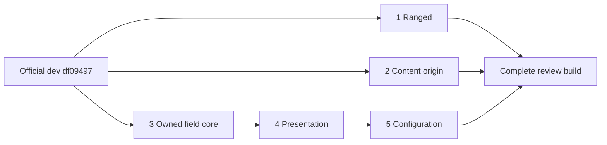

# Current Sandbox capability matrix

Scope: Sandbox `0.1.0+editor.8`, Lua implementation at `b67e8a344b942df1d65d7ce23939891bd74c9f59`; product Lua remains unchanged during this contribution task. The later English-only description changes the mod-source hash, not its Lua behavior. Owned game: Windows x64 CoE5 5.43, Steam build26458448, executable SHA256 `489d0b82fa790ec36e69a23e2335d0c2048fa57f4051fe8159c64f2d33508e55`.

Actual official dev fetched and rechecked: `df09497f04a39ff8fb7b0979dedde7dfed120c64`, tree `4ec6e2870c3b63081f842b4fb12bff5049a83eca`, CoE5SE3.4.4/API14. The old3.4.0 experiment is evidence/source input, not the base or proof of current compatibility. No original dirty checkout was reset or used as an upstream branch.

## Boundaries and order

Ranged and provenance are independent. Core must keep generation/ownership, creation, removal, rollback, empty mode and exact spells coherent: shipping removal without identity/cleanup would reintroduce the phantom-unit failure. Presentation and configuration are explicitly stacked. The complete branch cherry-picks the two independent changes onto the stack; it is a review/test integration, not one proposed monolithic PR. There are no merge commits.

Stock dev already has loaded tables, UI/layout, INI persistence, ordinary test fields/placement/fights, twenty-slot equipment helpers, compatibility machinery, spell metadata/lists and ordinary item/memorization primitives. Its `get("monsterMod",id)` identifies a monster's defining mod; this is not the missing item/spell/school writer history and no extra Modded Units feature was added. Raw item/spell writes are not an equivalent to generation-bound validate/readback/rollback transactions. Stock legacy fields require a first friendly commander and cannot safely become empty by deleting it.

## Complete function inventory

This source scan covers **60 function/member names**, including `ui` aliases, guarded legacy fallbacks and diagnostic helpers. `api.ui` itself is a table, not another function. [CSV with exact call locations](API-INVENTORY.csv). Supporting individual-actor `testFieldUnitState`, retained legacy `testBattle`/`fireTestField` compatibility and internal generation hooks support the core contract; they are distinguished from the current mod's direct imports.

| Function | Stock equivalence | Contribution | Use and limits |
|---|---|---|---|
| `addMainMenuButton` | Present; reused | upstream | Existing native UI/layout/input, persistence, catalog, reporting or legacy fallback; reused without replacing upstream implementation. |
| `addTestFieldUnits` | Present, behavior extended | core | Native incremental allocation/deployment; entire-request unique preflight and identity/lifecycle tracking. |
| `battleCellToScreen` | No equivalent owned-editor contract | presentation | Project native cell centers for drawing/preview. |
| `battleObjectAt` | Present; reused | upstream | Existing native UI/layout/input, persistence, catalog, reporting or legacy fallback; reused without replacing upstream implementation. |
| `battleScreenToCell` | No equivalent owned-editor contract | presentation | Inverse native projection for actual battlefield hit testing. |
| `battleUnitAt` | Present; reused | upstream | Existing native UI/layout/input, persistence, catalog, reporting or legacy fallback; reused without replacing upstream implementation. |
| `battleView` | No equivalent owned-editor contract | presentation | Current native camera/viewport during a valid battle drawing frame. |
| `closeTestField` | Present, behavior extended | core | Retire all owned actors, including off-square survivors; verify borrowed world context and neighbors. |
| `drawTestField` | Present; reused | upstream | Existing native UI/layout/input, persistence, catalog, reporting or legacy fallback; reused without replacing upstream implementation. |
| `fightTestField` | Present, behavior extended | core | Refuse missing teams before mutation; preserve native combat and normal no-value success behavior. |
| `findMonster` | Present; reused | upstream | Existing native UI/layout/input, persistence, catalog, reporting or legacy fallback; reused without replacing upstream implementation. |
| `get` | Present; reused | upstream | Existing native UI/layout/input, persistence, catalog, reporting or legacy fallback; reused without replacing upstream implementation. |
| `giveItem` | Present; legacy fallback only, not atomic/configuration-equivalent | upstream | Existing native UI/layout/input, persistence, catalog, reporting or legacy fallback; reused without replacing upstream implementation. |
| `inspectTestFieldFinalUnit` | No equivalent owned-editor contract | presentation | Inspect a still-valid current survivor record; do not substitute frozen stats/template identity. |
| `inspectTestFieldItem` | No equivalent owned-editor contract | presentation | Genuine loaded item card in the owning editor, verified unchanged actors afterward. |
| `inspectTestFieldUnit` | No equivalent owned-editor contract | presentation | Genuine current instance card, read-only, preserved configuration verified afterward. |
| `listIni` | Present; reused | upstream | Existing native UI/layout/input, persistence, catalog, reporting or legacy fallback; reused without replacing upstream implementation. |
| `loadedContentOrigin` | monsterMod exists for monsters; no equivalent item/spell/school observed-writer query | origin | Current item/school filters; native schools also include observed mod spells. Partial provenance, not a content validity or full-history proof. |
| `memorizeAllowance` | Present; reused | upstream | Existing native UI/layout/input, persistence, catalog, reporting or legacy fallback; reused without replacing upstream implementation. |
| `memorizeSpell` | Present; legacy fallback only, not atomic/configuration-equivalent | upstream | Existing native UI/layout/input, persistence, catalog, reporting or legacy fallback; reused without replacing upstream implementation. |
| `memorizeTestFieldSpell` | No equivalent owned-editor contract | core | Known/effective-level/capacity checks and exact rollback, scoped to the editor. |
| `monsterHasRanged` | Present, behavior extended | ranged | Native ranged category at catalog/main menu, in fields and after close. |
| `moveTestFieldUnit` | Present, behavior extended | core | Actual native collision/footprint deployment with ownership/life/read-only guards. |
| `observe` | Present; reused | upstream | Existing native UI/layout/input, persistence, catalog, reporting or legacy fallback; reused without replacing upstream implementation. |
| `openTestField` | Present, behavior extended | core | Existing entry point extended with terrain, emptyEditor and allowMultipleUnique; old positional/table callers retained. |
| `readIni` | Present; reused | upstream | Existing native UI/layout/input, persistence, catalog, reporting or legacy fallback; reused without replacing upstream implementation. |
| `removeTestFieldUnit` | No equivalent owned-editor contract | core | Retire one owned generation, clear anchors and verify hit cells; never apply battle death/kill effects. |
| `set` | Present; reused | upstream | Existing native UI/layout/input, persistence, catalog, reporting or legacy fallback; reused without replacing upstream implementation. |
| `setTestFieldConfiguration` | No equivalent owned-editor contract | configuration | Generation/session-bound validated loadout/school/spell transaction, readback and verified rollback; explicit cursed removal. |
| `setTestFieldSpells` | No equivalent owned-editor contract | core | Validate, restore and verify exact ordered known/memorized arrays without rerandomization. |
| `setTestFieldTextFocus` | No equivalent owned-editor contract | presentation | Own committed SDL text and control keys in the editor; preserve native window/focus events. |
| `spellInfo` | Present; reused | upstream | Existing native UI/layout/input, persistence, catalog, reporting or legacy fallback; reused without replacing upstream implementation. |
| `takeItem` | Present; legacy fallback only, not atomic/configuration-equivalent | upstream | Existing native UI/layout/input, persistence, catalog, reporting or legacy fallback; reused without replacing upstream implementation. |
| `takeTestFieldTextEvents` | No equivalent owned-editor contract | presentation | Bounded UTF-8 events with overflow/focus status; no typed text in logs. |
| `testFieldEditorCapabilities` | No equivalent owned-editor contract | core | Non-mutating feature metadata and loaded spell capacity. Advertisement is not a successful install or runtime acceptance test. |
| `testFieldFinalState` | No equivalent owned-editor contract | presentation | Timed actor/cell capture after aftermath before upkeep, immutable query; sceneComplete=false. |
| `testFieldFootprint` | No equivalent owned-editor contract | presentation | Read actual native width/height without allocating another actor. |
| `testFieldLifecycle` | No equivalent owned-editor contract | core | Verify close/borrowed-context cleanup instead of trusting an open handle or a boolean. |
| `testFieldLoadoutState` | No equivalent owned-editor contract | configuration | Complete twenty-position, base/template/bonus/effective/allowance and exact spell readback. |
| `testFieldPlacementPreflight` | No equivalent owned-editor contract | presentation | All footprint cells, occupied/terrain/outside status, explicitly partial; native placement is authoritative. |
| `testFieldPointerButtons` | No equivalent owned-editor contract | core | Stable SDL physical button mask; avoid native frame-mask clearing/repeated same-cell attempts. |
| `testFieldSpellState` | No equivalent owned-editor contract | core | Exact bounded native lists and school/allowance diagnostics for one owned actor. |
| `testFieldState` | No equivalent owned-editor contract | core | Bijection, life/team/type, anchors/full footprints, raw grid and derived occupied hit cells; complete/issue flags. |
| `testFieldTerrains` | No equivalent owned-editor contract | core | Advertised loaded neutral-land positive list; Plain/Forest/Mountains/Swamp/Desert. No water/siege/campaign equivalence. |
| `ui.bindEscape` | Present; reused | upstream | Existing native UI/layout/input, persistence, catalog, reporting or legacy fallback; reused without replacing upstream implementation. |
| `ui.buttonRow` | Present; reused | upstream | Existing native UI/layout/input, persistence, catalog, reporting or legacy fallback; reused without replacing upstream implementation. |
| `ui.drawItemIconFit` | No equivalent owned-editor contract | presentation | Fit the real native item sprite to a rectangle. |
| `ui.drawMonsterIconFit` | No equivalent owned-editor contract | presentation | Fit the real native monster sprite to a rectangle, returning measured source/destination dimensions. |
| `ui.drawRect` | Present; reused | upstream | Existing native UI/layout/input, persistence, catalog, reporting or legacy fallback; reused without replacing upstream implementation. |
| `ui.drawText` | Present; reused | upstream | Existing native UI/layout/input, persistence, catalog, reporting or legacy fallback; reused without replacing upstream implementation. |
| `ui.nameBox` | Present; reused | upstream | Existing native UI/layout/input, persistence, catalog, reporting or legacy fallback; reused without replacing upstream implementation. |
| `ui.screenBegin` | Present; reused | upstream | Existing native UI/layout/input, persistence, catalog, reporting or legacy fallback; reused without replacing upstream implementation. |
| `ui.screenWidth` | Present; reused | upstream | Existing native UI/layout/input, persistence, catalog, reporting or legacy fallback; reused without replacing upstream implementation. |
| `ui.sectionBegin` | Present; reused | upstream | Existing native UI/layout/input, persistence, catalog, reporting or legacy fallback; reused without replacing upstream implementation. |
| `ui.sectionEnd` | Present; reused | upstream | Existing native UI/layout/input, persistence, catalog, reporting or legacy fallback; reused without replacing upstream implementation. |
| `ui.text` | Present; reused | upstream | Existing native UI/layout/input, persistence, catalog, reporting or legacy fallback; reused without replacing upstream implementation. |
| `ui.wait` | Present; reused | upstream | Existing native UI/layout/input, persistence, catalog, reporting or legacy fallback; reused without replacing upstream implementation. |
| `unmemorizeSpell` | Present; legacy fallback only, not atomic/configuration-equivalent | upstream | Existing native UI/layout/input, persistence, catalog, reporting or legacy fallback; reused without replacing upstream implementation. |
| `wrap` | Present; reused | upstream | Existing native UI/layout/input, persistence, catalog, reporting or legacy fallback; reused without replacing upstream implementation. |
| `writeIni` | Present; reused | upstream | Existing native UI/layout/input, persistence, catalog, reporting or legacy fallback; reused without replacing upstream implementation. |

## Ordinary getters and writes

All **38** getter keys below are reused upstream capabilities. The scan expands the diagnostic get wrapper, dynamic known/memorized list readers and the team-color loop. `monster` reads human/animal/undead/demonic/flying flags; `monsterAbility` checks unique. `terrain` reads batmap. These getter names alone do not supply full native lifecycle/configuration consistency.

| Getter | Current source locations |
|---|---|
| `battleRound` | sandbox/report.lua:52; sandbox/ui.lua:800 |
| `battleWidth` | sandbox/runtime.lua:331; sandbox/runtime.lua:472 |
| `battleWinner` | sandbox/report.lua:52; sandbox/ui.lua:800 |
| `itemLastIndex` | sandbox/catalog.lua:72 |
| `itemName` | sandbox/catalog.lua:73; sandbox/runtime.lua:25 |
| `itemSlotType` | sandbox/catalog.lua:75 |
| `modEnabled` | sandbox/catalog.lua:56; sandbox/diagnostics.lua:156 |
| `modLastIndex` | sandbox/catalog.lua:55; sandbox/diagnostics.lua:155 |
| `modName` | sandbox/catalog.lua:56; sandbox/diagnostics.lua:156 |
| `monster` | sandbox/catalog.lua:63 |
| `monsterAbility` | sandbox/runtime.lua:278; sandbox/runtime.lua:455; sandbox/ui.lua:265 |
| `monsterLastIndex` | sandbox/catalog.lua:58 |
| `monsterName` | sandbox/catalog.lua:59 |
| `monsterSprite` | sandbox/catalog.lua:61 |
| `mouseButtons` | sandbox/ui.lua:24; sandbox/ui.lua:681; sandbox/ui.lua:684; sandbox/ui.lua:704; sandbox/ui.lua:707 |
| `screenH` | sandbox/config_window.lua:178; sandbox/config_window.lua:20; sandbox/ui.lua:436; sandbox/ui.lua:442 |
| `screenW` | sandbox/config_window.lua:178; sandbox/config_window.lua:20; sandbox/ui.lua:436; sandbox/ui.lua:442; sandbox/ui.lua:62 |
| `slotColorBlue` | runtime.lua: dynamic spellList / team-color loop |
| `slotColorGreen` | runtime.lua: dynamic spellList / team-color loop |
| `slotColorRed` | runtime.lua: dynamic spellList / team-color loop |
| `squareTerrain` | sandbox/runtime.lua:330 |
| `terrain` | sandbox/catalog.lua:105 |
| `terrainLastIndex` | sandbox/catalog.lua:103 |
| `terrainName` | sandbox/catalog.lua:104; sandbox/report.lua:53 |
| `ticksMs` | sandbox/diagnostics.lua:150; sandbox/diagnostics.lua:27; sandbox/diagnostics.lua:31; sandbox/report.lua:38; sandbox/report.lua:54 |
| `uiPointerX` | sandbox/ui.lua:593; sandbox/ui.lua:604; sandbox/ui.lua:99 |
| `uiPointerY` | sandbox/ui.lua:593; sandbox/ui.lua:604; sandbox/ui.lua:99 |
| `unitBattleX` | sandbox/diagnostics.lua:56; sandbox/report.lua:30; sandbox/report.lua:70; sandbox/runtime.lua:350; sandbox/runtime.lua:383 |
| `unitBattleY` | sandbox/diagnostics.lua:56; sandbox/report.lua:30; sandbox/report.lua:70; sandbox/runtime.lua:350; sandbox/runtime.lua:383 |
| `unitHp` | sandbox/diagnostics.lua:56; sandbox/integrity.lua:15; sandbox/report.lua:17; sandbox/report.lua:21; sandbox/report.lua:63; sandbox/ui.lua:370 |
| `unitItem` | sandbox/integrity.lua:10; sandbox/runtime.lua:24 |
| `unitKills` | sandbox/report.lua:40; sandbox/report.lua:69 |
| `unitKnownSpell` | runtime.lua: dynamic spellList / team-color loop |
| `unitMemorizedSpell` | runtime.lua: dynamic spellList / team-color loop |
| `unitMonster` | sandbox/diagnostics.lua:58; sandbox/integrity.lua:15 |
| `unitOwner` | sandbox/diagnostics.lua:58; sandbox/integrity.lua:15; sandbox/report.lua:77 |
| `unitX` | sandbox/diagnostics.lua:57 |
| `unitY` | sandbox/diagnostics.lua:57 |

Writes use only `mouseButtons` (consume UI input tails) and `slotColorRed/Green/Blue` for temporary teams0/24, with saved colors restored at close. The mod does not write shared monster/item definitions to emulate instance configuration.

Hooks imported by the production mod: BATTLE_DRAW and BATTLE_WAIT wrappers; DOATTACK, DAMAGE_UNIT and BATTLE_TURN_EFFECTS observations. They provide partial synchronous damage/item-spell attribution, not complete combat telemetry. The Extender adds a scoped constructor generation tap, unique lookup tap, optional two training readers/native attack adjustment and timed upkeep wrapper. New owned-field hooks install lazily only after an explicit field-open request; no new editor hook installs at launch. Other upstream feature settings/imports are retained. The API call is the opt-in, rather than a new global drawing/timing setting; this choice is stated for maintainer review.

## Platform and safety limits

Windows5.43 only for the new owned editor. Mac uses the exact upstream legacy test-field Git blob `24df1eb0b0f6b5931dc6b1674faaa9208950ff06`; editor capabilities are0, terrain list empty, new options explicitly refuse `windows_only`, and new bindings/text/fitted helpers are guarded. Host preprocessing is not Mac compilation. No Zig0.16 compiler or runnable Mac game is available; no Mac build/runtime pass is claimed. Portable provenance paths also remain Mac-untested.

Capability metadata is advertisement, not proof of successful hook installation or correct gameplay. First open/actual operations remain authoritative; failed installation disables capabilities. Failed rollback/cleanup is never success: preserve scenario/recovery, quarantine and require explicit recovery/restart. Raw exports are bounded and do not claim full snapshots. Removal retires/tombstones native records; full table compaction/reclamation and exhaustion are not proven.

Supported restoration is equipment, existing base schools and ordered known/memorized lists. Full native HP/injury/affliction/opaque instance state is not serialized: Crystal Heart removal retained live mask4194304, but a rebuilt actor had0. New implants/new arbitrary schools/higher base editing remain unsupported. Final capture excludes effects/projectiles/animations; current-record Inspect is separate. Natural conversions/transformations, every mod/camera/drag combination, campaigns/multiplayer and other game versions remain unaccepted.

## Generated files and review rules

New addresses are centralized in game_addresses.h; the two generated address index files are manually synchronized as CONTRIBUTING.md permits, with FNV1a IDs/sorted rows. The core adds one Windows unique-constructor callsite; presentation adds six camera/Inspect mappings. Mac entries remain explicitly unavailable. Configuration adds two training entries to entry_hook_sites.h: current upstream has53 per platform, and the resulting table has55 per platform without dropping existing resistance/flag entries. The maintainer regenerates these on acceptance. No proprietary executable, extracted asset, disassembly, private raw diagnostic, credential or binary belongs to a branch.

Every review commit is intentionally unsigned pending the user's explicit contribution-terms decision. These branches are not submission-ready and no PR/issue/message was sent. See [test results](TEST-RESULTS.md), [branch plan](README.md) and the five draft descriptions.
